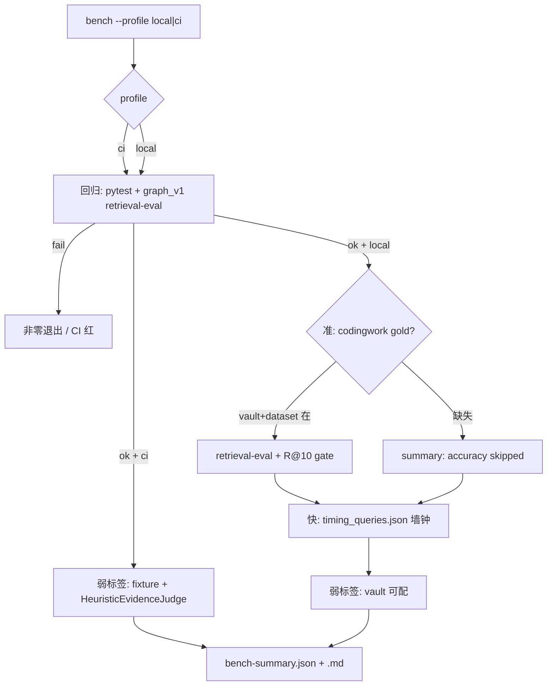

# 固定 Bench 套件：local + CI 同入口四轨评测

**Date:** 2026-11-09  
**Branch:** v1.0.0  
**Status:** Approved design — **本 commit 只含本设计文档**；实现另开 plan  
**Prior art:**  
- `uv run llm-wiki-mcp retrieval-eval`（R/P/MRR/nDCG、无答案误命中、P95、baseline gate）  
- `tests/fixtures/retrieval/graph_v1/`（CI 确定性图评测）  
- `tests/retrieval/`（检索契约与组件回归）  
- `HeuristicEvidenceJudge`（`src/retrieval/sag2_evidence.py`，本地启发式，无外呼）  
- codingwork gold / 墙钟 A/B 产物（本机 `/tmp/sag2-eval/`，不入库）

**Context:** v1.0.0 将 `sag2_hop` 设为默认 Query V2 路径并接召回刀 1+2 后，codingwork gold R@10 ≈ **0.84**，但相对 v0.9.36 墙钟中位从约 **0.2s** 升到约 **6–7s**。需要一套 **固定、可重复** 的 bench：本地一键看准/快/回归/弱标签；CI 同入口只跑确定性轨，缺真实 vault 不红。

---

## §1 目标与边界

### 目标

提供 **同一 CLI 入口** 的固定 bench 套件，服务两类受众：

| 受众 | 用途 |
|------|------|
| **本地开发者** | 改检索路径后一键跑准、快、回归、弱标签，产出统一 summary |
| **CI** | 同入口 `--profile ci`：只跑确定性回归 + fixture 弱标签；失败可红 |

四轨：

| 轨 | 测什么 | 本地 | CI |
|----|--------|------|-----|
| **回归** | `pytest tests/retrieval` + `graph_v1` 上的 `retrieval-eval` | ✓ | ✓ |
| **准** | codingwork gold：R@k / Precision / MRR / nDCG（沿用现有 `retrieval-eval` 口径） | ✓（本机 vault + dataset 路径可配） | **跳过**（缺真实 vault 不红） |
| **快** | 固化 5 题墙钟：mean / p50 / p95；可选对比 baseline commit 报告 | ✓ | **跳过** |
| **弱标签** | 对 top-k 用 **仅** `HeuristicEvidenceJudge` 打 relevance 伪分；可选 citation 覆盖率 | ✓（codingwork 或 fixture） | ✓（**仅** fixture vault） |

成功标准（本设计 + 后续实现验收）：

- 本地 `--profile local` 四轨都能跑完并写出 `bench-summary.json` + Markdown。  
- CI `--profile ci` 只跑回归 + fixture 弱标签；codingwork / timing 缺失时 **跳过且绿**。  
- 无外呼、无托管 JEV、无向量库依赖、不把真实 vault 正文提交进仓库。

### 路线选择

| 选项 | 内容 | 决策 |
|------|------|------|
| **编排 CLI** | `bench --profile local\|ci` 包一层现有 `pytest` / `retrieval-eval` / 计时 / Judge | **本文件采用** |
| 新 `src/eval/bench_suite` 大包 | 统一 runner + 新报告 schema 深层抽象 | **不做**（第一版过重） |
| 只扩 Actions + 文档两套命令 | CI 与本地命令分叉 | **不做**（易漂移） |
| 公榜 BEIR / RAGAS / 外呼 judge | 语料不对齐或违禁外传 | **不做** |

### 做 / 不做

| 做 | 不做 |
|----|------|
| CLI 子命令 `bench`，`--profile local\|ci`，`--output-dir` 必填或可配 | BEIR / MS MARCO / NQ 等公榜 |
| 复用 `retrieval-eval`、`pytest tests/retrieval`、`graph_v1` fixture | RAGAS 或任何外呼 LLM judge |
| 弱标签：**仅** `HeuristicEvidenceJudge.score`；有 gold 时可附「金页是否进 top-k」弱命中 | 向量 / Embedding 作为 bench 默认路径 |
| 固化 timing 题集于 `tests/fixtures/bench/timing_queries.json` | 第一版消融矩阵（graph/hop/刀开关全组合） |
| 统一 `bench-summary.json` + `.md` | 端到端答案 EM / 生成质量评测 |
| CI workflow 调同一 `bench --profile ci` | 把 codingwork vault / gold 提交进 git |
| README 一小节用法 | 本 commit 改应用代码 |

### 门禁

| 轨 | 门禁 |
|----|------|
| **回归（CI）** | 失败 → **红**（pytest 非零退出，或 graph_v1 `retrieval-eval` 相对其冻结 baseline 的既有 gate 失败） |
| **弱标签** | **仅报告**，不因伪分高低红灯 |
| **准（本地）** | 默认 **R@10 ≥ 0.75**，阈值可通过 CLI / 配置覆盖；未达标 → 本地非零退出（FAIL_LOUD），CI 不跑此轨故不影响 CI |
| **快** | **无硬门禁**；只写入 JSON（mean / p50 / p95、分题耗时、可选 vs baseline Δ） |

### 仍保留

- `retrieval-eval` 作为准轨与 graph 回归的底层报告格式不变。  
- 本地 EvidenceJudge 默认启发式；禁止托管 JEV / 为判证外传 vault。  
- 仓库内 `tests/fixtures/retrieval/` 只做确定性框架验证，不作生产 vault 基线。

---

## §2 架构

### 入口与 profile

```text
uv run llm-wiki-mcp bench --profile local|ci --output-dir <dir> [覆盖项…]
```

| Profile | 执行顺序 | 跳过条件 |
|---------|----------|----------|
| **local** | 回归 → 准 → 快 → 弱标签 → 写 summary | 准：缺 `--vault`/`--dataset`（或默认本机路径不存在）时 **跳过并在 summary 标 skipped**，不假装达标；快：缺 timing fixture 则失败（fixture 应入库） |
| **ci** | 回归 → fixture 弱标签 → 写 summary | **永不**跑 codingwork 准轨或真实 vault 计时 |

覆盖项（实现 plan 落具体 flag 名；设计锁定语义）：

- `--output-dir`：报告根；其下可再分子目录 `regression/`、`accuracy/`、`latency/`、`weak_label/`。  
- 准轨：`--vault`、`--dataset`、`--accuracy-r10-min`（默认 `0.75`）。  
- 快轨：`--timing-queries`（默认 `tests/fixtures/bench/timing_queries.json`）、可选 `--latency-baseline-report`。  
- 弱标签：`--weak-label-vault` / dataset（ci 默认 `graph_v1`；local 可指向 codingwork）。  
- `--skip-accuracy` / `--skip-latency` 等显式跳过（不影响 ci 默认跳过语义）。

### 各轨如何落地

#### 回归

1. 子进程或同进程调用：`pytest tests/retrieval -q`（实现可选收窄 markers；默认整包检索回归）。  
2. 对 `tests/fixtures/retrieval/graph_v1` 跑只读 `retrieval-eval`（engine / lexical；与现有 CLI 一致），输出写入 `--output-dir/regression/`。  
3. 若提供冻结 baseline JSON，沿用现有 `retrieval-eval` baseline gate；未提供则只产出报告，不因「无生产基线」虚构 pass/fail。  
4. pytest 非零 → bench **失败退出**（CI 红）。

#### 准（仅 local）

1. 调用现有 `retrieval-eval`：`--entrypoint engine`、词法默认、codingwork vault + 版本化 JSONL/manifest。  
2. 默认路径约定（可覆盖，**不入库**）：例如本机 `codingwork-vault` + `codingwork-gold.jsonl`（开发者本机或 CI 外缓存）；仓库只文档化约定，不提交正文。  
3. 从 `retrieval-eval.json` 读取 R@10；与 `--accuracy-r10-min`（默认 **0.75**）比较；不达标 → 非零退出，summary 写明基线阈值与实测。  
4. CI profile **不调度**本轨。

#### 快（仅 local）

1. 读取固化题集 `tests/fixtures/bench/timing_queries.json`（第一版 **5** 条 answerable 查询；可含 `id`、`query`、可选 filters；**不含** vault 正文）。  
2. 对当前工作树默认 Query V2 路径（与 MCP/`run_query_v2` 同口径）逐题测墙钟；记录每题秒数、`hops_run` / 刀触发等已有遥测字段（有则写入，无则省略）。  
3. 汇总 mean / median(p50) / p95；写入 `--output-dir/latency/`。  
4. 若传入 baseline 报告，输出逐题与汇总 Δ；**不**因变慢红灯。  
5. CI profile **不调度**本轨。

题集选取原则（固化进 fixture，实现时写入具体 5 条）：覆盖 Latin 标识符、CJK、混合、短缓存命中与慢 hop/judge 题；优先与既有 A/B（v0.9.36 vs v1.0.0）同题，保证前后可对比。

#### 弱标签（heuristic-only）

1. 对选定 vault 跑查询（ci：`graph_v1` cases；local：可同准轨 dataset 或 fixture）。  
2. 对每个 query 的 top-k 命中调用 `HeuristicEvidenceJudge.score(question, passage_text, title=…, page_path=…)`，**禁止** `LocalLlmEvidenceJudge` 外的 HTTP/托管路径；本轨 **不**加载可选本地 LLM scorer。  
3. 报告伪指标（仅报告，不门禁）：  
   - top-1 / top-k **mean evidence**、**max evidence**；  
   - 有 gold `relevant` 路径时：**金页是否出现在 top-k** 的弱命中率（与正式 R@k 分立字段，避免与准轨混淆）；  
   - **citation 覆盖率**（若结果含 `citation_trace` / 等价引用字段）：有引用锚点的命中占比；无该字段则标 `unavailable`，不失败。  
4. 零外呼、零 egress；分数已由 Judge clamp 到 `[0,1]`。

### 数据流



### 报告契约

`--output-dir` 下至少产出：

| 文件 | 内容 |
|------|------|
| `bench-summary.json` | `profile`、`started_at`/`finished_at`、各轨 `status`（`pass`/`fail`/`skipped`/`report_only`）、关键数字（R@10、latency p50/p95、pytest 退出码、弱标签均值）、子报告相对路径 |
| `bench-summary.md` | 同内容人类可读表 |
| 子目录报告 | 各轨底层产物（`retrieval-eval.json`、pytest 日志摘录、latency JSON、weak-label JSON） |

建议默认输出落在调用方传入目录；文档可示例 `reports/bench/<timestamp>/`，该路径 **gitignore**，不把真实评测报告推进主分支。

### 与现有工具的边界

| 组件 | 角色 |
|------|------|
| `retrieval-eval` | 准轨 + graph 回归的唯一正式指标引擎 |
| `pytest tests/retrieval` | 契约/组件回归 |
| `HeuristicEvidenceJudge` | 弱标签唯一打分器 |
| `quality-gate calibrate` / gold sample|finalize | **不**纳入第一版 bench 编排（仍可手工用） |
| MCP `wiki_query` | 快轨应对齐其引擎路径；ci 不强制走 MCP 传输层 |

---

## §3 落地清单与验收

### 交付物（实现 plan 拆任务；本 commit 不含代码）

1. **CLI：** `bench` 子命令 + `--profile local|ci` + `--output-dir` + 准/快/弱标签路径与门禁覆盖项。  
2. **编排：** 包一层现有 `pytest`、`retrieval-eval`、计时循环；弱标签小模块只调 `HeuristicEvidenceJudge`。  
3. **固化 fixture：** `tests/fixtures/bench/timing_queries.json`（5 题）；CI 使用既有 `graph_v1`，不新增真实语料。  
4. **CI：** workflow（或现有 job）调用 `uv run llm-wiki-mcp bench --profile ci --output-dir …`；回归失败红；弱标签失败仅当 runner 崩溃（指标本身不门禁）。  
5. **文档：** README 一小节（local 四轨 / ci 两轨、默认 R@10 门禁、报告路径）；本设计文件保留为决策源。  
6. **忽略规则：** 确保 `reports/bench/`（或文档约定目录）不被误提交；设计/fixture 用 `git add -f` 如被 `docs/*` 忽略。

### 验收

| # | 条件 |
|---|------|
| 1 | 本地 `bench --profile local`：四轨调度正确；准轨在 vault 可用时写出 R@k 并执行默认 **R@10≥0.75**；快轨写出 5 题耗时与 p50/p95；弱标签写出 heuristic 伪分且无网络请求 |
| 2 | `bench --profile ci`：只跑回归 + fixture 弱标签；不访问 codingwork 路径；回归失败非零退出 |
| 3 | 统一 `bench-summary.json` + `bench-summary.md` 含各轨 status 与子报告链接 |
| 4 | 无 BEIR/RAGAS/向量默认路径/外呼 judge/答案 EM；无真实 vault 正文入库 |
| 5 | 弱标签轨不因分数触发红灯；准轨不达标仅影响 local 退出码 |

### 本设计 commit 范围

- **仅**本文件写入 `docs/specs/2026-11-09-bench-suite-design.md`（若 `docs/*` 被 ignore 则 `git add -f`）。  
- **不**改应用代码、不 push、不开实现（实现另开 plan / 任务）。

---

## 实现提示（非本 commit）

建议实现顺序：

1. 固化 `timing_queries.json`（5 题）+ summary schema 单测（fixture 级）。  
2. CLI `bench` 骨架：`ci` 先接通 pytest + graph_v1 `retrieval-eval` + summary。  
3. 弱标签模块（Judge only）接 ci fixture，再接 local。  
4. local 准轨包 `retrieval-eval` + R@10 门禁；快轨墙钟循环。  
5. README + CI workflow；手工跑通 local 四轨与 ci 两轨。

后续可选项（**非**本设计范围）：消融矩阵、可选本地 LLM 弱标签、latency 硬门禁、与 `quality-gate calibrate` 编入同一入口。
