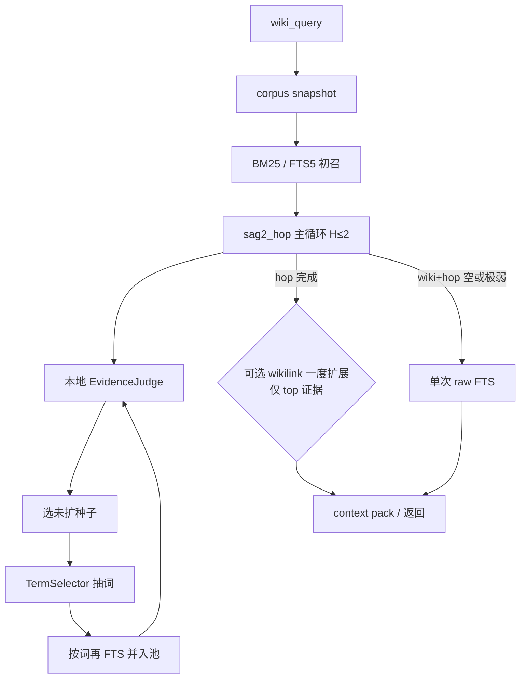

# SAG2 Hop 默认主路径设计（llm-wiki-mcp）

**Date:** 2026-11-09  
**Branch:** explore-v0.9.36 / v0.9.36  
**Status:** Approved design — **本 commit 只含本设计文档**；实现另开 plan  
**Paper:** [SAG2: Embedding-Free Multi-Hop Retrieval with BM25 and JEV](https://arxiv.org/abs/2610.22588)（Zleap / Yuchao Wu；约 2026）  
**Prior designs:**  
- `docs/specs/2026-10-19-retrieval-p1-raw-ladder-design.md`  
- `docs/specs/2026-10-19-retrieval-p2-cluster-c-design.md`  
- `docs/specs/2026-10-20-retrieval-p2-coverage-page-union-design.md`（0015）  
- `docs/specs/2026-10-20-retrieval-p2-raw-pool-cooccur-design.md`（0008）  
- `docs/specs/2026-10-20-retrieval-p2-primary-strong-fts-slice-design.md`（0018）  
- `docs/specs/2026-10-20-retrieval-p2-title-token-bar-design.md`  

---

## §1 目标与边界

### 目标

用设计文档把 **llm-wiki-mcp Query V2** 与 **SAG2**（BM25 → 证据判定 → 抽词扩检 → 最多 2 轮）在架构上一一对齐，作为日后实现的蓝图。

成功标准（本设计阶段）：**架构对齐论文 §3**（初召、判证、抽词、扩检、停机、多样性），不以 gold Recall 数字为门禁。

### 路线演进

| 阶段 | 决策 |
|------|------|
| 初拟 Approach A | 旁路可选阶段 `sag2_hop`（默认关），P2 ladder 与图扩展保留 |
| **冻结（本文件）** | **`sag2_hop` 成为正式默认检索主路径**；P2 ladder **不再**作为默认兜底 |

Approach A 的「旁路」形态仅作历史对照；实现时按本文件的 **default main path** 落地。

### 做 / 不做

| 做 | 不做 |
|----|------|
| `sag2_hop` 默认主路径：BM25/FTS5 → 本地 EvidenceJudge → 抽词扩检 → `H≤2` | 托管 JEV / 任何外传 vault 的证据 API |
| 本地证据判定（规则默认；可插本地 LLM） | 默认开启向量检索 |
| 保留 MCP `wiki_query` 用法、Markdown SoT、SQLite FTS、wikilink 图 | 整仓替换为 SAG2 上游代码 |
| design-only：本 commit 仅文档 | 本 commit 不改应用代码 |
| 去掉默认 P2 ladder | 把 P2 ladder 留作默认分级兜底 |

### 明确废弃为默认的 P2 ladder

下列在今日 Query V2 中的 **默认分级兜底** 不再作为主路径：

1. `coverage`（未覆盖 Latin 词）  
2. `wiki_relaxed`  
3. `all_coverage`  
4. `raw_zero`  

以及叠在其上的 P2 补丁（实现阶段可删除或仅留测试对照）：

- **0008** phrase / cooccur（raw pool）  
- **0015** coverage page-union  
- **0018** primary strong FTS slice / title-token denylist  

实现后：旧 ladder 行为不应在默认 `wiki_query` 路径上触发；对照测试若保留，须显式开关且默认关。

### 仍保留

- MCP 工具模型（`wiki_query` 等）  
- Markdown 为事实源（SoT）  
- SQLite FTS5 + BM25 索引  
- wikilink 图（**hop 之后**可选扩展，见 §2）  
- **本地-only** 证据判定：禁止托管 JEV；禁止为判证外传 vault 正文  

---

## §2 架构

### 默认主路径（散文）

1. `wiki_query(q)` 进入检索。  
2. 取 corpus **snapshot**（与现有一致）。  
3. **BM25 / FTS5 初召**（现有 `passages_fts` / LexicalIndex）。  
4. **`sag2_hop` 主循环（默认开，`H≤2`）**  
   - 本地 `EvidenceJudge` 对候选段落打分；  
   - 选尚未扩检的高分种子；  
   - 从种子抽词 / 短语；  
   - 按词再 FTS，并入候选池，带共享上下文再判；  
   - 无新候选或无可用扩词则停。  
5. **（可选）wikilink 图扩展**：放在 hop **之后**，只对 top 证据做一度扩展；**不**参与扩词。  
6. **context pack** / 返回 MCP 结果。  

**Raw FTS：** 仅当 wiki 池经 hop 后仍为空或极弱时，做 **单次** raw FTS；不再走 coverage → relaxed → raw_zero 阶梯。  

**向量：** 仍为 opt-in，不进入默认主路径。

### Mermaid

### 与论文 / 旧路径的关系

| 概念 | SAG2 论文 | 本设计 |
|------|-----------|--------|
| 初召 | BM25 top-B | 现有 FTS5 BM25 |
| 证据 | 托管 JEV | **本地** EvidenceJudge |
| 多跳 | Algorithm 1，H 轮 | `Sag2HopController`，默认 `H=2` |
| 图 | 无 wikilink | hop **后**可选 GraphExpand |
| 兜底 | — | 单次 raw；**无** P2 ladder |

---

## §3 组件细节

### 3.1 LexicalIndex（沿用）

- 继续使用现有 SQLite `passages_fts`（BM25）。  
- 字段权重可对照论文 title / heading / body 分层；实现阶段再调，本设计不锁死具体权重表。  
- CJK 继续走现有 tokenizer；不因 SAG2 对齐而改成仅英文分词。

### 3.2 Sag2HopController

实现论文 **Algorithm 1** 的本地版，默认参数（与论文量级对齐，可配置）：

| 符号 | 默认 | 含义 |
|------|------|------|
| `B` | ≈100 | 初召池大小 |
| `s` | ≈10 | 每轮选取的未扩种子数（top） |
| `L` | ≈20 | 每种子抽词上限 |
| `H` | 2 | 最大 hop 轮数 |

行为要点：

- 每轮：对当前池打证据分 → 更新 History → 选未扩种子 → 抽词 → 词级 FTS → 交错去重并入池 → 带上下文再判。  
- **停机：** 达到 `H`；或无新候选；或无可用扩词。  
- **多样性：** 扩词与候选并入时去重，避免同页反复占满池（对照论文多样性约束）。

### 3.3 EvidenceJudge（本地）

- **接口：** `(q, passage, context) → score ∈ [0, 1]`。  
- **默认实现：** 规则启发式（query 覆盖度、标识符 / 短语命中、句级重叠、种子权重等）。  
- **可选钩子：** 本地 LLM 打分；本地 LLM 不可用时 **必须** 回退规则 Judge。  
- **禁止：** 托管 JEV、任何把 vault 段落发到外网的判证路径。  
- 实现阶段用配置 / 接口边界保证可插拔；默认路径零外呼。

### 3.4 TermSelector

- 从种子正文抽取 token 与多词名实体。  
- **排除：** 纯问句功能词、df=0 的词。  
- **权重（设计级）：** 频次 × 稀有度 × 句–query 连接 × 该种子证据分。  
- 输出供 Controller 做词级 FTS 扩检。

### 3.5 GraphExpand（可选后置）

- 仅在 hop **完成之后**运行。  
- 只对 hop 后 **top 证据** 做 wikilink **一度**扩展。  
- **不**把图邻居当作扩词来源；图扩展与 TermSelector 解耦。

### 3.6 Pack / Telemetry

- 返回原文段落 + 检索路径信息（便于 citation / debug）。  
- 记录：hop 轮次、判证次数、扩词集合摘要、是否触发单次 raw。  
- **无外传**；telemetry 仅本地 / MCP 响应字段。  
- 旧 P2 ladder 相关 telemetry 字段标为 **deprecated**（见 §4）。

---

## §4 数据流与错误处理

### 输入与索引

- `wiki_query(q)` → snapshot。  
- **无可用索引：** 返回明确错误；**不**静默降级到旧 P2 ladder。

### 主循环

- 每轮：`W` 打分 → 更新 History → 选种子抽词 → 词级 FTS。  
- 任一步导致「无进展」（无新候选 / 无扩词）：**提前结束**，返回已有排序结果。

### 判证失败

- 单条失败：该条记 **0 分** 或跳过，**不**中断整轮。  
- 本地 LLM Judge 不可用：回退规则 Judge。

### 预算与超时

- 判证次数上限约「论文量级」，可配置。  
- 超时：截断当前轮，返回已排序结果（带 telemetry 标明截断）。

### Raw 兜底

- **仅当** wiki + hop 结果为空或极弱时，执行 **一次** raw FTS。  
- 仍失败：空结果 + 诊断字段（原因码），不进入旧 ladder。

### MCP 兼容

- 对外响应字段保持可读 / 稳定；新增 hop 相关字段用可扩展对象挂载。  
- 旧 P2 telemetry（coverage / wiki_relaxed / all_coverage / raw_zero / 0008·0015·0018 钩子计数等）标记 **deprecated**；实现阶段可读但不作为主路径信号。

---

## §5 测试与验收（设计层）

### 主验收：论文对齐

文档与实现伪代码须能逐步对照论文 **§3.1–3.5** 与 **Algorithm 1**：

1. BM25 初召  
2. 证据判定  
3. 抽词  
4. 扩检并入  
5. 停机条件  
6. 多样性 / 去重  

本设计阶段 **不**把 MuSiQue / HotpotQA / 本地 gold 的 Recall@k 当作通过门禁。

### 单测契约（实现阶段）

- Controller：轮次上限、停机、种子不重复扩。  
- TermSelector：排除纯问句词；df=0 不入扩词集。  
- EvidenceJudge：接口本地-only；配置禁止外网时 **不得** 发起 HTTP（负向断言）。  
- 默认路径：不触发 P2 ladder 阶段名。

### 回归

- 实现阶段再跑现有 gold / eval；数字改善是加分项，**不是**本设计的成立条件。  
- 若保留 ladder 对照测试，须显式非默认开关。

### 负向

- 离线 / 禁止外网配置下，Judge 与 hop 全路径无 HTTP。

---

## Self-review（文档）

| 检查项 | 结果 |
|--------|------|
| 无 TBD / TODO 占位 | 通过：参数与边界均已冻结 |
| §1–§5 与聊天批准一致 | 通过：default hop、去 P2 ladder、本地判证、图后置、单次 raw、向量 opt-in |
| 范围仅设计 | 通过：明确本 commit 不改应用代码 |
| 与既有 specs 关系 | 通过：列出 P1/P2 文档为 prior；声明其默认路径地位被本设计取代 |
| 成功标准 | 通过：架构对齐论文 §3，非 recall 门禁 |

---

## 落地提示（非本 commit）

实现时建议顺序：

1. 抽出 `EvidenceJudge` + `TermSelector` 接口与规则默认实现。  
2. 实现 `Sag2HopController` 并接到 `wiki_query` 默认路径。  
3. 关闭 / 拆除默认 P2 ladder；raw 改为单次弱兜底。  
4. GraphExpand 接到 hop 之后。  
5. 单测契约 + 离线无 HTTP；再视需要跑 gold。

本文件批准后即可另开 implementation plan；**不在此文档内改代码。**
