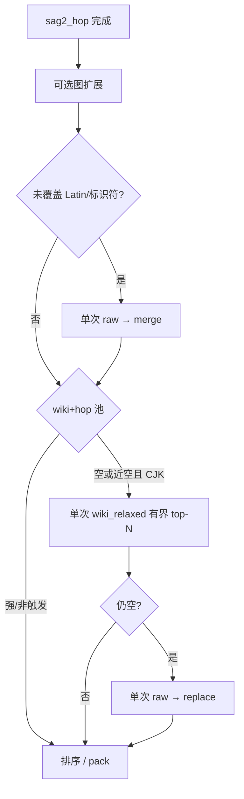

# SAG2 召回第二刀：空洞感知 raw merge + 空池/CJK 有界 wiki_relaxed

**Date:** 2026-11-09  
**Branch:** v1.0.0  
**Status:** Approved design — **本 commit 只含本设计文档**；实现另开 plan  
**Prior designs:**  
- `docs/specs/2026-11-09-sag2-hop-default-design.md`（v1.0.0 主路径：hop 默认、单次 raw、无 P2 ladder）  
- `docs/specs/2026-11-09-sag2-recall-lift-merge-judge-design.md`（第一刀：弱池 raw merge + Judge 标题/CJK/标识符；gold 未达 0.80）  

**Context:** Approach A（弱池 merge + Judge 加权）落地后 codingwork gold R@10 ≈ **0.643**（相对 P2 ≈ **0.833** 仍差约 0.19；相对 hop 基线 ≈ **0.665** 略降）。诊断相对 P2 的 miss 主因不是「raw 冲 wiki」，而是 **缺 coverage→raw** 与 **CJK/空池 wiki_relaxed**。本设计取刀 1+2：空洞感知 raw（merge）+ 空池/CJK 有界 `wiki_relaxed` 单发；门禁本轮降为 **R@10 ≥ 0.75**。

---

## §1 目标与边界

### 目标

在 **v1.0.0** hop 默认路径上做召回第二刀（knife 1+2）：

1. **空洞 / 未覆盖 Latin（及标识符）→ raw merge**：问句中未覆盖的 Latin/标识符触发 **一次** raw FTS，结果 **merge** 进 wiki+hop（非整池 replace）。  
2. **wiki 空池或 CJK 空召 → 有界 `wiki_relaxed` 单发**：wiki+hop 空或几乎无命中且含 CJK 时，发 **单次** `wiki_relaxed` FTS，有界 top-N；仍空再走现有 empty→raw replace。

成功标准（本设计 + 后续实现验收）：

- **行为：** 不恢复 coverage→relaxed→raw_zero **整条** P2 ladder；遥测记下触发原因。  
- **数字：** 同口径 codingwork gold **R@10 ≥ 0.75**。

### 路线选择

| 选项 | 内容 | 决策 |
|------|------|------|
| **刀 1** | 空洞感知 raw → merge | **本文件采用** |
| **刀 2** | 空池/CJK 有界 wiki_relaxed 单发 | **本文件采用** |
| 刀 3 | 收敛图扩展 / bonus 排序抖动 | **本轮后置**（约 +0.02 保底） |
| 全梯 | 恢复 P2 coverage→relaxed→raw_zero 默认 | **不做** |

### 做 / 不做

| 做 | 不做 |
|----|------|
| 问句未覆盖 Latin/标识符 → **一次** raw FTS → **merge** | 恢复整条 P2 ladder 为默认兜底 |
| wiki+hop 空或近空且含 CJK → **单次** `wiki_relaxed`（有界 top-N） | 默认开启向量 / 托管 JEV / 外传 vault |
| 仍空时沿用 empty→raw **replace** | 本 commit 改应用代码 |
| telemetry 记录触发原因（coverage_raw / cjk_relaxed / empty_raw 等） | 本轮强制做刀 3 排序抖动收敛 |

### 仍保留（相对 v1.0.0 + 第一刀）

- `sag2_hop` 默认主路径、`H≤2`  
- 弱池 raw **merge** / 空池 raw **replace**（第一刀语义）  
- 图扩展在 hop 之后；P2 ladder 仅显式 legacy 开关  
- 本地 EvidenceJudge（含第一刀标题/CJK/标识符 bonus）；无外呼

---

## §2 行为

### Coverage → raw merge

在 hop（及既有图扩展 / 弱池 merge 时机）之后，检测问句中 **未覆盖** 的 Latin token / 标识符式 token：

| 条件 | 行为 | Telemetry（示意） |
|------|------|-------------------|
| 存在未覆盖 Latin / identifier | **一次** raw FTS → 命中 **merge** 进 wiki+hop 候选 | `coverage_raw_merge`（或等价字段） |
| 无不覆盖空洞 | 不因 coverage 触发 raw | （无 coverage raw 事件） |

要点：

- **merge，非整池 replace**：保留既有 wiki/hop（及第一刀弱池 merge 已并入的条目）。  
- 与第一刀「弱池 top evidence &lt; 阈值 → raw merge」可并存；实现需去重，避免同一 raw 命中双计。  
- 去重键与现有 passage/page 身份一致。  
- 排序：merge 后仍按既有证据分 / 检索分约定（实现 plan 写清与 coverage 段的 tie-break）。

### 空池 / CJK → 有界 wiki_relaxed 单发

| 条件 | 行为 | Telemetry（示意） |
|------|------|-------------------|
| wiki+hop **空**，或几乎无命中 **且** query 含 CJK | **单次** `wiki_relaxed` FTS，结果 **有界 top-N** 并入 | `wiki_relaxed_cjk` / `wiki_relaxed_empty` |
| relaxed 后仍空 | 再走现有 **empty → raw replace** | `raw_replace`（既有） |
| 强池 / 非空且非 CJK 空召 | 不因本规则触发 relaxed | — |

要点：

- **单发、有界**：不是 P2 的 coverage→relaxed→raw_zero 全梯；不做多级 relaxed 回退链。  
- top-N 上界由实现配置（设计要求「有界」，不强制本文件锁死具体 N）。  
- CJK 判定：query 含 CJK 字符即可作为触发信号之一；「几乎无命中」阈值实现 plan 写清。

### 与 P2 ladder 的关系

- **不**默认打开 `enable_legacy_p2_ladder`。  
- 本设计只把诊断里有效的两段信号（coverage raw、CJK/空池 relaxed）以 **有界单发** 形式接回 hop 路径。  
- 禁止借本设计恢复完整 ladder 行为。

### 数据流（相对 v1.0.0 + 第一刀）

---

## §3 验收

### 单测契约

1. **coverage → raw merge：** 问句有未覆盖 Latin/标识符时触发一次 raw；既有 wiki/hop 保留；telemetry 标明 coverage 触发。  
2. **CJK / 空池 → 单次 relaxed：** 空池或近空+CJK 时触发 **一次** `wiki_relaxed`；不触发多级 ladder。  
3. **不恢复全梯：** 显式断言默认路径不会跑 coverage→relaxed→raw_zero 全链（legacy 开关关闭时）。

### Eval

- 同口径 **codingwork gold**：实现后跑既有评测协议。  
- **门禁：R@10 ≥ 0.75**。  
- **未达标：** 在实现 PR / 报告中 **FAIL_LOUD**（基线、实测、差分），**不得**静默宣称达标。

### 本设计 commit 范围

- **仅**本文件写入 `docs/specs/`。  
- **不**改应用代码、不 push、不开实现（实现另开 plan / 任务）。

---

## 实现提示（非本 commit）

建议实现顺序：

1. 单测先写：coverage raw merge；CJK/空池单次 relaxed；默认无全梯。  
2. 接 coverage→raw merge + telemetry。  
3. 接空池/CJK → 有界 wiki_relaxed 单发；仍空 → raw replace。  
4. 跑 codingwork gold；对照第一刀后 ≈0.64 → 目标 ≥ 0.75。

若 R@10 仍不足，再评估刀 3（图扩展/bonus 抖动）或调 top-N / 空洞定义，**不**默认回退整条 P2 ladder。
