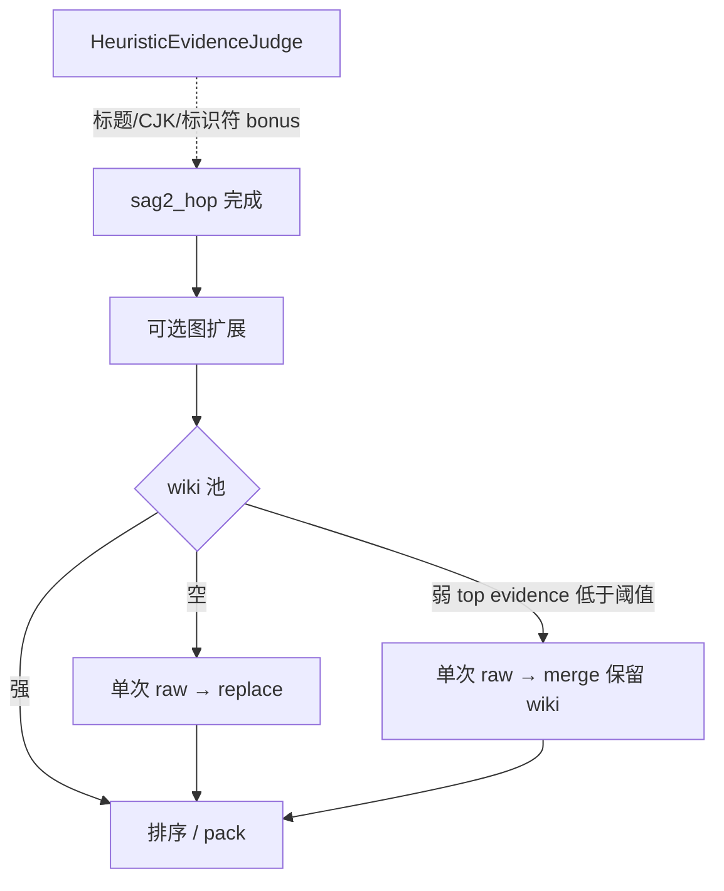

# SAG2 召回回升：弱池 raw merge + Judge 标题/CJK/标识符加权

**Date:** 2026-11-09  
**Branch:** v1.0.0  
**Status:** Approved design — **本 commit 只含本设计文档**；实现另开 plan  
**Prior designs:**  
- `docs/specs/2026-11-09-sag2-hop-default-design.md`（v1.0.0 主路径：hop 默认、单次 raw、无 P2 ladder）  
- `docs/plans/2026-11-09-sag2-hop-default.md`（实现 plan；已落地）  

**Context:** v1.0.0 将 P2 ladder 换为 SAG2 式 hop 后，codingwork gold R@10 约 **0.665**（P2 基线约 **0.833**）。归因上优先怀疑两处：弱 hop 后 raw **整池 replace** 冲掉勉强命中的 wiki；`HeuristicEvidenceJudge` 对 **标题 / CJK / 标识符** 不友好，种子误杀导致扩词无料。

---

## §1 目标与边界

### 目标

在 **v1.0.0** 上做召回第一刀（Approach A）：

1. **弱 hop 后的 raw**：由整池 **replace** 改为 **merge**（**空池仍 replace**）。  
2. **`HeuristicEvidenceJudge`**：对标题/路径 token、CJK 连续片段、标识符式 token 增加**有界**加权。

成功标准（本设计 + 后续实现验收）：

- **行为：** 弱池不得冲掉既有 wiki 命中。  
- **数字：** 同口径 codingwork gold **R@10 ≥ 0.80**。

### 路线选择

| 选项 | 内容 | 决策 |
|------|------|------|
| **A（本文件）** | 空池 replace；弱池 merge；Judge 标题/CJK/标识符加权 | **采用** |
| B | 只抬弱阈值 + merge，不动 Judge | 不做（CJK 种子仍可能弱） |
| C | A + TermSelector 保留问句稀有专名 | **本轮后置** |

### 做 / 不做

| 做 | 不做 |
|----|------|
| 弱池（top evidence &lt; 阈值）raw **append/merge** | 恢复 P2 ladder 为默认兜底 |
| 空池 raw **replace**（保持现状语义） | TermSelector「问句稀有专名保留」（Approach C） |
| Judge 标题/路径、CJK span、identifier-like **bounded bonus** | 托管 JEV / 外传 vault |
| clamp 到 `[0,1]`；本地-only | 默认开启向量检索 |
| telemetry 区分 `raw_merge` vs `raw_replace` | 本 commit 改应用代码 |

### 仍保留（相对 v1.0.0 主路径）

- `sag2_hop` 默认主路径、`H≤2`  
- 单次 raw 兜底（本文件只改 **何时 replace vs merge**）  
- 图扩展在 hop 之后；P2 ladder 仅显式 legacy 开关  
- 本地 EvidenceJudge；无外呼

---

## §2 行为

### Raw 兜底：空池 replace / 弱池 merge

在 hop（及既有图扩展时机）之后，对 wiki 候选池：

| 池状态 | 行为 | Telemetry |
|--------|------|-----------|
| **空池**（无 wiki/hop 候选） | 单次 raw FTS → **replace** 为 raw 结果 | `raw_replace` |
| **弱池**（存在候选，但 top evidence score **&lt; 阈值**） | 单次 raw FTS → 命中 **append/merge** 进候选池；**保留**既有 wiki/hop 条目 | `raw_merge` |
| **强池**（top evidence ≥ 阈值） | 不触发 raw | （无 raw 事件，或既有「未触发」字段） |

要点：

- **弱池不得整池冲掉 wiki**：merge 是 append/去重并入，不是用 raw 列表替换整个结果集。  
- 阈值沿用现实现有「极弱」判定（实现时可配置，但本设计不强制改默认数值；行为语义以 merge vs replace 为准）。  
- 去重键与现有 passage/page 身份一致，避免同一段因 merge 双计。  
- 排序：merge 后仍按既有证据分 / 检索分约定排序（实现 plan 写清是否需微调 tie-break）。

### HeuristicEvidenceJudge 有界加权

在现有重叠启发式之上，对下列信号加 **bounded bonus**（有上界，避免单维刷满）：

1. **标题 / 路径 token**：query 与 passage 所属页面 title、路径片段的 token 重叠。  
2. **CJK 连续片段**：query 与正文中的 CJK span 匹配（改善相对 Latin 重叠的偏置）。  
3. **标识符式 token**：如 `snake_case`、`CamelCase`、含数字/下划线的专名等 identifier-like 形态命中。

约束：

- 最终分数 **clamp 到 `[0,1]`**。  
- **本地-only**：禁止 HTTP / 托管 JEV；本地 LLM 不可用时仍走规则 Judge。  
- Bonus 为增量，不替换现有覆盖度 / 句级重叠逻辑。

### 数据流（相对 v1.0.0）

---

## §3 验收

### 单测契约

1. **弱池 merge：** 已有 wiki 命中在 raw 触发后仍保留；结果含 raw 新段；telemetry 为 `raw_merge`。  
2. **空池 replace：** 无 wiki 候选时 raw 仍 **replace**；telemetry 为 `raw_replace`。  
3. **Judge：** 同 query 下，标题命中 / CJK span / identifier 命中的 passage 分数 **高于** 仅弱正文重叠的对照；分数落在 `[0,1]`；无外呼断言仍成立。

### Eval

- 同口径 **codingwork gold**：实现后跑既有评测协议。  
- **门禁：R@10 ≥ 0.80**。  
- **未达标：** 在实现 PR / 报告中**显式记录失败**（基线、实测、差分），**不得**静默宣称达标。

### 本设计 commit 范围

- **仅**本文件写入 `docs/specs/`。  
- **不**改应用代码、不 push、不开实现（实现另开 plan / 任务）。

---

## 实现提示（非本 commit）

建议实现顺序：

1. 单测先写：merge / replace / Judge bonus。  
2. 改 raw 弱池分支 + telemetry。  
3. 改 `HeuristicEvidenceJudge` 加权与 clamp。  
4. 跑 codingwork gold；对照 0.665 → 目标 ≥ 0.80。  

若 R@10 仍不足，再评估 Approach C（TermSelector 稀有专名）或调阈值 / merge 排序，**不**默认回退 P2 ladder。
